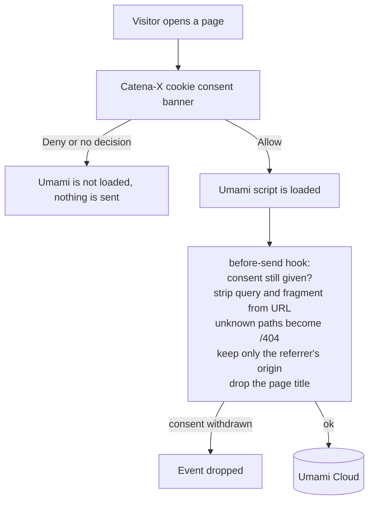

# Website analytics

This page explains how usage analytics work on <https://catenax-ev.github.io>: which rules they follow, how they are
built, and what is tracked and what is not.

## Why

We want to know how the Catena-X Library is used: which standards, rulebooks and other pages are read, how often the
search finds nothing, which pages people enter through and where visitors come from. The numbers help to prioritize
documentation work. They are reported in aggregate only; no individual visitor is tracked.

## Status

| Item | Status |
|---|---|
| Approval by Catena-X e.V. (data protection) | Open |
| Umami Cloud website | Created, website id `78991a15-003f-46f3-a153-b0f0cdac5038` |
| Read-only share link of the dashboard | Not created yet |

## Rules

| Rule | How it is met |
|---|---|
| No tracking without explicit consent | The site's own consent banner is shown on every page until the visitor decides. Umami is only loaded after "Allow". "Allow" and "Deny" are equally prominent. |
| Consent can be withdrawn at any time | "Cookie settings" in the footer opens the banner again |
| The banner links to the privacy policy | Link to the [Catena-X privacy policy](https://catena-x.net/privacy-policy/), also linked in the footer |
| Privacy-friendly analytics tool | [Umami Cloud](https://umami.is) (`cloud.umami.is`): sets no cookies and does not store IP addresses |
| Send as little as possible and store no personal information | Umami does not store IP addresses and sets no cookies. Query strings and fragments are removed from URLs, paths that are not a page of the site are sent as `/404`, referrers are reduced to their origin, page titles and search terms are never sent (see below) |
| No third-party requests before consent | The banner is part of the site; no external script or stylesheet is loaded for it |

## How it works



1. **Consent banner.** [`src/clientModules/cookieConsent.js`](src/clientModules/cookieConsent.js) shows the banner
   on every page until the visitor clicks "Allow" or "Deny". The decision is stored in the cookie
   `cx_cookieconsent_status` (`allow` or `deny`) for 90 days, see
   [`src/utils/consent.js`](src/utils/consent.js). It is a host-only cookie: the site runs on `catenax-ev.github.io`,
   and browsers reject cookies for `.github.io` because it is a public suffix. "Cookie settings" in the footer opens
   the banner again.
2. **Loading Umami.** [`src/clientModules/analytics.js`](src/clientModules/analytics.js) runs on every page. It only
   adds the Umami script when the consent cookie is `allow`, either on page load or right after the visitor clicked
   "Allow".
3. **Checking every event.** Before Umami sends anything, the `before-send` hook in the same file checks the consent
   cookie again and drops the event if consent was withdrawn. It also removes the query string and fragment from the
   page URL and reduces the referrer to its origin, for example `https://www.google.com`. Paths that are not a page of
   the site (checked against the Docusaurus routes) are sent as `/404`: such paths are typed or linked by someone else
   and may contain anything, for example an e-mail address. Page titles are not sent: the search page puts the search
   term into its title (`Search results for "..."`), and that title can still be set for a moment after navigating
   away. The path identifies the page.
4. **Search outcome.** The site uses the local search plugin (`@easyops-cn/docusaurus-search-local`), which has no
   hook for its results. The analytics module therefore reads the outcome from the search dropdown in the navbar:
   once the visitor stopped typing for 1.5 seconds, or right away when a result or "See all results" is opened, it
   records `search` if results are shown for the current text and `search-no-results` if the dropdown shows
   "No results". The dropdown keeps showing the previous outcome while a new search runs, so it is only read once it
   was redrawn after the last keystroke. Every keystroke allows one new record, so a search is recorded once, and
   searching for the same text again after clearing the field counts as a new search.
5. **Only on the production site.** Umami only sends data from `catenax-ev.github.io` (`data-domains`). Branch
   previews, which are deployed under `/branch/<name>/`, do not load Umami at all. Local development (`npm start`) is
   never tracked.
6. **Do Not Track.** Umami respects the browser's Do Not Track setting (`data-do-not-track`).

## What is tracked

Only after the visitor allowed it:

| Data | Example | Used for |
|---|---|---|
| Page views, including client-side navigation; unknown paths as `/404` | `/docs/standards/overview` | Most visited pages |
| Origin of the referrer | `https://www.google.com` | Where visitors come from |
| Search outcome: event `search` (results found) or `search-no-results` | `search-no-results` | How often the search finds nothing |
| Information Umami derives from the request | Country, browser, operating system, device type, screen size, language | Aggregated reports |

Umami derives visits and sessions from a salted hash, without cookies. It uses the IP address of the request to
look up the country, but does not store it. Entry
pages, exit pages and time on page are calculated from the page views.

## What is not tracked

- Nothing at all without consent, or after consent was withdrawn.
- No cookies are set by Umami and no IP addresses are stored. The only cookie is the one that stores the consent
  decision.
- No search terms. What visitors type into the search may contain personal information, so only the outcome is
  recorded. Searches on the `/search` page count as a page view of `/search` only.
- No query strings or fragments of page URLs (for example `?q=...` or `#token=...`), and no paths that are not a
  page of the site (for example `/jane.doe@example.com`, sent as `/404`).
- No page titles. The search page has the search term in its title.
- No full referrer URLs, only their origin.
- No clicks, scrolling, form input or other interactions.
- No user accounts, names or e-mail addresses.
- No branch previews and no local builds.

## Configuration

| Setting | Where | Default |
|---|---|---|
| Umami website id | `umamiWebsiteId` in [`docusaurus.config.ts`](docusaurus.config.ts), environment variable `UMAMI_WEBSITE_ID` | `78991a15-003f-46f3-a153-b0f0cdac5038` |
| Umami script | `umamiScriptUrl`, environment variable `UMAMI_SCRIPT_URL` | `https://cloud.umami.is/script.js` |
| Tracked host | `analyticsHost`, environment variable `ANALYTICS_HOST` | `catenax-ev.github.io` |
| Privacy policy | `privacyPolicyUrl` | `https://catena-x.net/privacy-policy/` |

The website id is not a secret, it is part of every tracked page. To build the site without analytics and without the
banner, set `UMAMI_WEBSITE_ID` to an empty string.

## Access to the data

The data is available in the Umami Cloud dashboard. Read access is given through a read-only share link of the
dashboard, on request to the account owner.

## Testing

1. Open the website in a private browser window. The cookie banner is shown and the network tab shows no requests to
   `umami.is`.
2. Click "Deny" and navigate through some pages: still no requests to `umami.is`.
3. Click "Cookie settings" in the footer, then "Allow": the Umami script is loaded and every page view sends a
   request to `/api/send`, without query string or fragment.
4. Search for something without results: an event `search-no-results` is sent, without the search term.
5. Click "Cookie settings", then "Deny": no further requests are sent.
6. Restart the browser (not a private window): the banner is not shown again.

Requests are only sent on `catenax-ev.github.io`. The search index only exists in a production build, so test
locally with:

```bash
ANALYTICS_HOST=localhost npm run build && npm run serve
```

This sends real data to Umami with the host name `localhost`.

## Known limitations

- Visitors who withdraw consent keep the Umami script in the current page until they reload, but every event is
  dropped by the `before-send` hook.
- The search outcome is read from the search dropdown. An update of `@easyops-cn/docusaurus-search-local` that
  changes its markup (`input.navbar__search-input`, `role="listbox"`, `role="option"`, the "See all results" link)
  can stop the search events; page views are not affected.
- Changes to the analytics must keep this page and the rules above in sync.
