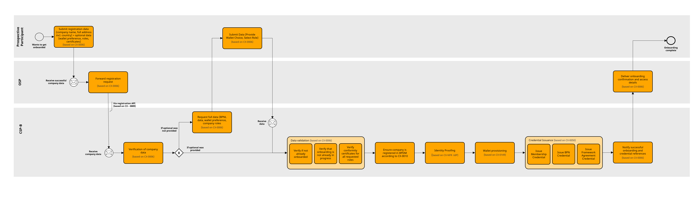

---
tags:
  - CAT/Portal
  - CAT/Core Service Provider-B
  - CAT/Onboarding Service Provider
---
# CX-0006 Registration and Initial Onboarding V2.2.0

## ABSTRACT

This standard describes the onboarding process a company must go through in order to become a member of the Catena-X dataspace and gain access to dataspace services.
The onboarding process starts with providing initial information to an OSP.
The OSP then forwards this initial information to the CSP-B, who gathers additional data, verifies the prospective participant's identity, and sets up the necessary infrastructure.
Onboarding concludes with the issuance of a Membership Credential from the CSP-B to the participant's wallet.

## 1 INTRODUCTION

### 1.1 AUDIENCE & SCOPE

> *This section is non-normative*

This standard is relevant for the following roles:

- Core Service Provider-B (CSP-B)
- Onboarding Service Provider (OSP)

### 1.2 CONTEXT AND ARCHITECTURE FIT

> *This section is non-normative*

In order to register new network participants the CSP operates a registration service. The prospective participant has the opportunity to directly provide their company details to initiate the registration process. Alternatively the participant can join the network via an Onboarding Service Provider (OSP).

The OSP guides the participant through the onboarding journey. The emphasis is on gathering organizational master data and processing the initial registration request. The OSP registers the participant via API through the OSP managed IDP. The OSP may collect all required data (including wallet preference, and agreement consents) and submit it on behalf of the prospective participant in a single registration request. Once the initial registration has been sent to the CSP-B, the OSP can track the status and support the prospective participant if needed. After validation by the CSP-B the newly joined network participant gets access to data space services, can operate their connector and participate in data exchanges.

The document deals with the initial registration process which is the initial
mandatory step for new Catena-X network participants. The technical API use for this process is described in [CX-0009 CX Registration API](../CX-0009-CXRegistrationAPI/CX-0009-CXRegistrationAPI.md).

The Catena-X registration is a structured, mandatory, and role-based process.  
It is invitation-based, and participants cannot register independently without a certified OSP or CSP-B.
Data space services will only be available after full validation by a CSP-B.

The following diagram provides a high-level view of the onboarding process and the interaction between the prospective participant, OSP, and CSP-B.

### 1.3 CONFORMANCE AND PROOF OF CONFORMITY

> *This section is non-normative*

As well as sections marked as non-normative, all authoring guidelines, diagrams, examples, and notes
in this specification are non-normative. Everything else in this specification is normative.

The keywords **MAY**, **MUST**, **MUST NOT**, **OPTIONAL**, **RECOMMENDED**, **REQUIRED**, **SHOULD**
and **SHOULD NOT** in this document document are to be interpreted as described in BCP 14 [RFC2119] [RFC8174]
when, and only when, they appear in all capitals, as shown here.

### 1.4 TERMINOLOGY

> *This section is non-normative*

| Term                    | Explanation                                                 |
|-------------------------|-------------------------------------------------------------|
| prospective participant | The company currently going through the onboarding process. |

## 2 MAIN CONTENT

> *This section is normative*

The individual subsections describe the onboarding process as a sequence of steps.
At the beginning of the process, the prospective participant is not associated with the Catena-X dataspace.
At the end of the process, the prospective participant is a fully onboarded member of the Catena-X dataspace.

### 2.1 INITIAL REGISTRATION

> *This section is normative*

Initially, an OSP either contacts the prospective participant or is contacted by the prospective participant. The OSP **MUST** provide the possibility for the prospective participant to submit initial registration data.
The OSP **MUST** collect at least the following information about the prospective participant:

- company name and full address including country such that the legal entity can be unambiguously identified

The OSP **MAY** additionally collect the data described in [Section 2.2](#22-data-collection) during this step, so that the complete registration can be submitted to the CSP-B in a single request. Currently, this is limited to the Provider / Consumer role.

Once the prospective participant has submitted the registration data, the OSP **MUST** send the submitted data as a registration request to the CSP-B.

### 2.2 DATA COLLECTION

> *This section is normative*

Upon receiving a registration request from an OSP, the CSP-B **MAY** reject the request.

Data collection **MUST** include at least the following data:

- any data required for the creation of a BPNL as defined in [CX-0010 Business Partner Number](../CX-0010-BusinessPartnerNumber/CX-0010-BusinessPartnerNumber.md)
- whether the participant wishes to use their own wallet instance or be provided with a wallet instance by the CSP-B (see [CX-0149 Wallet Requirements](../CX-0149-WalletRequirements/CX-0149-WalletRequirements.md))
- consent to the [Governance Framework for Data Space Operations](https://catenax-ev.github.io/docs/regulatory-framework/governance-framework)

> *Note: At the time of writing, the Governance Framework includes the [Operating Model](https://catenax-ev.github.io/docs/operating-model/why-introduction), the [Ten Golden Rules](https://catenax-ev.github.io/docs/regulatory-framework/30000ft/ten-golden-rules), and the [Data Exchange Governance](https://catenax-ev.github.io/docs/regulatory-framework/20000ft/data-exchange-governance). The authoritative list of required agreements is defined by the Governance Framework itself.*

The CSP-B **MUST** provide to the prospective participant the possibility to submit the data listed above. It **MUST** skip this part if the data is already provided during the initial registration by the OSP.

In addition, the CSP-B **MUST** ensure that the prospective participant can indicate which roles (as defined in the [Catena-X Operating Model](https://catenax-ev.github.io/docs/operating-model/who-roles-in-the-catena-x-ecosystem)) it wants to obtain in the Catena-X dataspace.
Where applicable for a role, the prospective participant **MUST** provide the appropriate certificate of conformity obtained from a CAB.

### 2.3 DATA VALIDATION

> *This section is normative*

Once the data has been submitted by the prospective participant, the CSP-B **MUST** perform at least the following validation checks:

- verify that the prospective participant is not already onboarded
- verify that the prospective participant is not already in an ongoing registration process
- where applicable, verify the provided certificates of conformity for all requested roles

After successful validation, the CSP-B **MUST** ensure that a BPNL referring to the prospective participant is created, if it does not yet exist.

### 2.4 IDENTITY PROOFING

> *This section is normative*

The CSP-B **MUST** verify the identity of the prospective participant through an identity proofing process as defined in CX-XXXX Identity Proofing.

### 2.5 PARTICIPANT WALLET CREATION

> *This section is normative*

After this step is completed, every participant **MUST** have access to a wallet instance complying with [CX-0149 Wallet Requirements](../CX-0149-WalletRequirements/CX-0149-WalletRequirements.md), which also defines how the prospective participant may obtain such a wallet instance.

### 2.6 CREDENTIAL ISSUANCE

> *This section is normative*

The CSP-B **MUST** issue to the prospective participant a Membership Credential, a BPN Credential, and a Framework Agreement Credential, as defined in [CX-0050 Catena-X Specific Credentials](../CX-0050-CXSpecificCredentials/CX-0050-CatenaXSpecificVerifiableCredentials.md), provided that the conditions for the credential claims are met.
The issuance of the Membership Credential from the CSP-B to the prospective participant completes the onboarding process.

## 3 REFERENCES

> *This section is non-normative*

### 3.1 NORMATIVE REFERENCES

- [CX-0010 Business Partner Number](../CX-0010-BusinessPartnerNumber/CX-0010-BusinessPartnerNumber.md)
- [CX-0050 Catena-X Specific Credentials](../CX-0050-CXSpecificCredentials/CX-0050-CatenaXSpecificVerifiableCredentials.md)
- [CX-0149 Wallet Requirements](../CX-0149-WalletRequirements/CX-0149-WalletRequirements.md)
- [CX-NFR-IdP](../../rulebooks/CX-NFR-IdP)

### 3.3 REFERENCE IMPLEMENTATIONS

- [Tractus-X Portal Backend](https://github.com/eclipse-tractusx/portal-backend)

## LEGAL

Copyright © 2026 Catena-X Automotive Network e.V. All rights reserved. For more information, please see [Catena-X Copyright Notice](https://catenax-ev.github.io/copyright).
