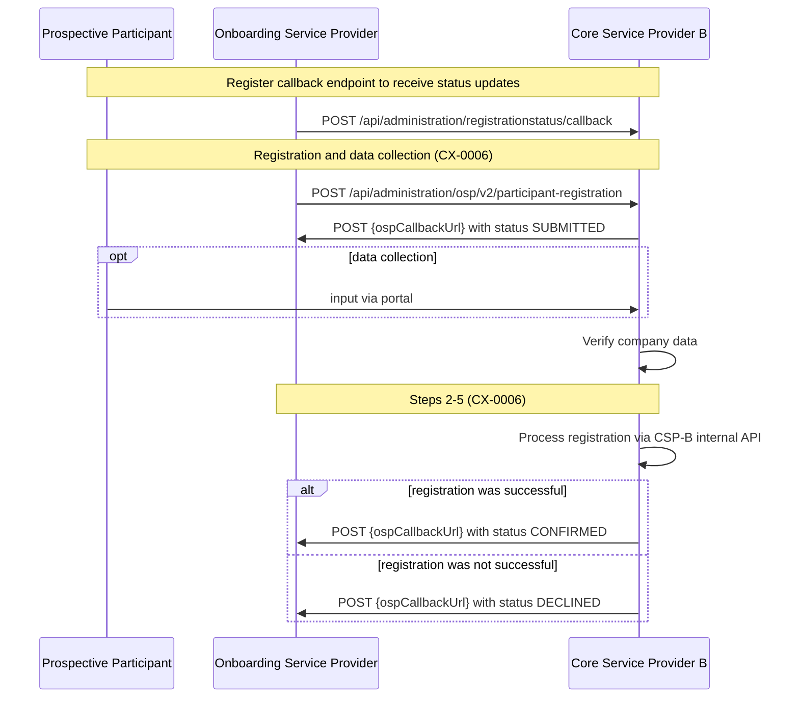

---
tags:
  - CAT/Portal
  - CAT/Core Service Provider
  - CAT/Sandbox Service Provider
  - CAT/Onboarding Service Provider
---

# CX-0009 CX Registration API v2.1.0

## ABSTRACT

This standard defines the Registration API for the Catena-X network. It specifies the endpoints that
a Core Service Provider B must implement to enable prospective participants to register.

## 1. Introduction

To become a participant of Catena-X, each prospective participant must go through a
registration process. Registration is a mandatory requirement for all
further activities within the Catena-X network. The registration
process, along with other services, provides the foundation of trust for
the Catena-X network.

### 1.1 Audience & Scope

> *This section is non-normative*

This standard is relevant for the following roles:

- Core Service Provider B
- Onboarding Service Provider

### 1.2 Context

> *This section is non-normative*

The registration API is used as part of the registration process.

### 1.3 Interactions

> *This section is non-normative*

A Core Service Provider B operates a registration API through which a registering company can enter
its data. The registration service may be accessed by an Onboarding Service Provider, on behalf of
a registering company.



### 1.4 Conformance

As well as sections marked as non-normative, all authoring guidelines,
diagrams, examples, and notes in this specification are non-normative.
Everything else in this specification is normative.

The keywords MAY, MUST, MUST NOT, OPTIONAL, RECOMMENDED, REQUIRED, SHOULD and SHOULD NOT
in this document are to be interpreted as described in
[BCP 14](https://datatracker.ietf.org/doc/html/bcp14)
[[RFC2119](https://www.w3.org/TR/did-core/#bib-rfc2119)\]
[[RFC8174](https://www.w3.org/TR/did-core/#bib-rfc8174)\] when, and
only when, they appear in all capitals, as shown here.

### 1.5 Proof of conformity

> *This section is non-normative*

All participants and their solutions must prove that they conform to the
Catena-X standards. To validate that the standards are
applied correctly, Catena-X employs Conformity Assessment Bodies (CABs).

Core Service Provider B implementations of their own registration solution MUST
prove their conformity by providing:

- OpenAPI specifications for the CSP-B endpoints and the OSP callback endpoint they implement

### 1.6 Terminology

> *This section is non-normative*

**Application Programming Interface (API)**

An application programming interface (API) is a way for two or more
computer programs to communicate with each other.

Additional terminology used in this standard can be looked up in the
glossary on the association homepage.

## 2. Catena-X Registration API

> *This section is normative*

A Core Service Provider B **MUST** implement the following endpoints. The API business logic,
content, and structure are required; the root path can differ. Details of the respective MUST
and SHOULD statements are described below.

### 2.1 Preconditions and dependencies

The registration API is exposed to the Internet.

The `<base>` notation indicates the base URL for an endpoint. For example, if the base URL is
`api.example.com`, the URL
`https://<base>/api/administration/registration/network/partnerregistration`
will map to
`https://api.example.com/api/administration/registration/network/partnerregistration`.

#### 2.1.1 Available Data Types

All Registration API control-plane request and response messages **MUST** use the
`application/json` media type. This excludes binary uploads to a storage-provider presigned URL.

*The examples in this document are non-normative. The provided OpenAPI documents are normative
machine-readable representations and MUST remain aligned with this specification.*

#### 2.1.2 API resources & endpoints

The HTTP endpoints introduced in this standard **MUST** implement authentication and authorization.

#### 2.1.3 Error Handling

HTTP standard response codes **MUST** be used.

### 2.2 Core Service Provider B

The CSP-B-hosted endpoints in this section are defined in the [Registration API OpenAPI specification](./assets/registration-api.yaml).

#### 2.2.1 Initiate registration

A Core Service Provider B **MUST** provide this endpoint to initiate a registration process.
**This legacy endpoint is retained for backward compatibility. New OSP integrations SHOULD use the participant registration endpoint defined in [Section 2.2.2](#222-initiate-participant-registration-by-osp)**
**Endpoint:** `POST https://<base>/api/administration/registration/network/partnerregistration`

**Required Role:** `configure_partner_registration`

| Field               | Type                                                   | Mandatory | Description                                                                                     |
| ------------------- | ------------------------------------------------------ | --------- | ----------------------------------------------------------------------------------------------- |
| `externalId`        | string                                                 | Mandatory | Unique identifier within the Onboarding Service Provider                                        |
| `name`              | string                                                 | Mandatory | Company name                                                                                    |
| `city`              | string                                                 | Mandatory | City of the company address                                                                     |
| `streetName`        | string                                                 | Mandatory | Street name of the company address                                                              |
| `countryAlpha2Code` | string                                                 | Mandatory | ISO 3166-1 alpha-2 country code (e.g. `DE`)                                                     |
| `region`            | string                                                 | Mandatory | Region / state                                                                                  |
| `companyRoles`      | array of [`CompanyRoleId`](#companyroleid)             | Mandatory | Roles the company will take on                                                                  |
| `uniqueIds`         | array of [`CompanyUniqueIdData`](#companyuniqueiddata) | Mandatory | Company unique identifiers                                                                      |
| `userDetails`       | array of [`UserDetailData`](#userdetaildata)           | Mandatory | Initial user(s) to be created for the company                                                   |
| `bpn`               | string                                                 | Optional  | If the prospective participant already has a Business Partner Number, the OSP provides it here. |
| `shortName`         | string                                                 | Optional  | Company short name                                                                              |
| `streetNumber`      | string                                                 | Optional  | Street number                                                                                   |
| `streetAdditional`  | string                                                 | Optional  | Additional street info                                                                          |
| `zipCode`           | string                                                 | Optional  | Postal / ZIP code                                                                               |

<details>
<summary>Example Request</summary>

```json title="partnerRegistrationData.json"
{
  "externalId": "a1b2c3d4-e5f6-7890-abcd-ef1234567890",
  "name": "Example GmbH",
  "city": "Munich",
  "streetName": "Main street",
  "streetNumber": "42",
  "streetAdditional": null,
  "zipCode": "80331",
  "region": "BY",
  "countryAlpha2Code": "DE",
  "bpn": "BPNL000000055EPN",
  "shortName": "ExGmbH",
  "uniqueIds": [
    {
      "type": "COMMERCIAL_REG_NUMBER",
      "value": "HRB 123456"
    }
  ],
  "userDetails": [
    {
      "identityProviderId": "3fa85f64-5717-4562-b3fc-2c963f66afa6",
      "providerId": "ext-user-001",
      "username": "jane.doe",
      "firstName": "Jane",
      "lastName": "Doe",
      "email": "jane.doe@example.com"
    }
  ],
  "companyRoles": ["ACTIVE_PARTICIPANT"]
}
```

</details>

**Response Body**

n/a

**Response Codes**

| HTTP Status | Description                             |
| ----------- | --------------------------------------- |
| `200`       | Registration successfully initiated     |
| `401`       | Unauthorized - missing or invalid token |
| `500`       | Internal Server Error                   |

---

#### 2.2.2 Initiate participant registration by OSP

A Core Service Provider B **MUST** provide this endpoint to initiate a registration process for a participant invited by the OSP. The role of the invited company is excluded from the onboarding request because it is implied to be Data Provider and Data Consumer only.

**Endpoint:** `POST https://<base>/api/administration/osp/v2/participant-registration`

**Required Role:** `configure_partner_registration`

| Field               | Type                                                   | Mandatory | Description                                                                                                                                  |
| ------------------- | ------------------------------------------------------ | --------- | -------------------------------------------------------------------------------------------------------------------------------------------- |
| `externalId`        | string                                                 | Mandatory | Unique identifier within the Onboarding Service Provider                                                                                     |
| `name`              | string                                                 | Mandatory | Company name                                                                                                                                 |
| `city`              | string                                                 | Mandatory | City of the company address                                                                                                                  |
| `streetName`        | string                                                 | Mandatory | Street name of the company address                                                                                                           |
| `countryAlpha2Code` | string                                                 | Mandatory | ISO 3166-1 alpha-2 country code (e.g. `DE`)                                                                                                  |
| `region`            | string                                                 | Optional  | Region / state                                                                                                                               |
| `uniqueIds`         | array of [`CompanyUniqueIdData`](#companyuniqueiddata) | Mandatory | Company unique identifiers                                                                                                                   |
| `userDetails`       | array of [`UserDetailData`](#userdetaildata)           | Mandatory | Initial user(s) to be created for the company                                                                                                |
| `shortName`         | string                                                 | Optional  | Company short name                                                                                                                           |
| `streetNumber`      | string                                                 | Optional | Street number                                                                                                                                |
| `streetAdditional`  | string                                                 | Optional  | Additional street info                                                                                                                       |
| `siteDetail`        | [`SiteDetailData`](#sitedetaildata)                    | Mandatory | Data required to create a BPNS as specified in [CX-0010][cx-0010]                                                                            |
| `zipCode`           | string                                                 | Mandatory | Postal / ZIP code                                                                                                                            |
| `did`               | string                                                 | Optional  | Decentralized Identifier used to receive the Verifiable Credentials during the onboarding process, when required by the CSP-B configuration. |
| `consents`          | array of [`Consent`](#consent)                         | Mandatory | Array of consent the OSP has collected from the customer. MUST include all three required kinds.                                             |

<details>
<summary>Example Request</summary>

```json title="participantRegistrationData.json"
{
  "externalId": "a1b2c3d4-e5f6-7890-abcd-ef1234567890",
  "name": "Example GmbH",
  "city": "Munich",
  "streetName": "Main street",
  "countryAlpha2Code": "DE",
  "region": "BY",
  "uniqueIds": [
    {
      "type": "COMMERCIAL_REG_NUMBER",
      "value": "HRB 123456"
    }
  ],
  "userDetails": [
    {
      "identityProviderId": "3fa85f64-5717-4562-b3fc-2c963f66afa6",
      "providerId": "ext-user-001",
      "username": "jane.doe",
      "firstName": "Jane",
      "lastName": "Doe",
      "email": "jane.doe@example.com"
    }
  ],
  "shortName": "ExGmbH",
  "streetNumber": "42",
  "streetAdditional": null,
  "siteDetail": {
    "name": "Main Plant Munich",
    "city": "Munich",
    "streetName": "Factory road",
    "countryAlpha2Code": "DE",
    "region": "BY",
    "streetNumber": "7",
    "zipCode": "80331"
  },
  "zipCode": "80331",
  "did": "did:web:teaching-especially-rodent.ngrok-free.app",
  "consents": [
    {
      "kind": "CX_DATA_EXCHANGE_GOVERNANCE",
      "fileIds": []
    },
    {
      "kind": "CX_OPERATING_MODEL",
      "fileIds": []
    },
    {
      "kind": "CX_TEN_GOLDEN_RULES",
      "fileIds": []
    }
  ]
}
```

</details>

**Response Body**

n/a

**Response Codes**

| HTTP Status | Description                                                                          |
| ----------- | ------------------------------------------------------------------------------------ |
| `201`       | Registration request successfully created                                            |
| `401`       | Unauthorized - missing or invalid token                                              |
| `409`       | Conflict - a registration request already exists with this `externalId` for this OSP |
| `500`       | Internal Server Error                                                                |

---

#### 2.2.3 File Upload Endpoint

If files, such as documents, are required to process a registration request and are provided to the CSP-B by an OSP, the CSP-B **MUST** provide this endpoint.
Otherwise, the CSP-B **MAY** provide this endpoint.
All files **MUST** be successfully uploaded before the registration request is submitted.

**Endpoint:** `POST https://<base>/api/administration/osp/v2/participant-registration/fileupload`

**Required Role:** `configure_partner_registration`

**Request Body** — `FileUploadRequest`

| Field         | Type   | Mandatory | Description                                                                                         |
| ------------- | ------ | --------- | --------------------------------------------------------------------------------------------------- |
| `fileName`    | string | Mandatory | Name of the file the OSP intends to upload                                                          |
| `externalId`  | string | Mandatory | To correlate this file with the registration request                                                |
| `contentType` | string | Mandatory | [RFC 2046](https://www.rfc-editor.org/rfc/rfc2046) media type of the file the OSP intends to upload |

**Response Body**

| Field                | Type   | Mandatory | Description                                                                                 |
| -------------------- | ------ | --------- | ------------------------------------------------------------------------------------------- |
| `fileId`             | string | Mandatory | Unique ID assigned to this file                                                             |
| `presignedUploadUrl` | string | Mandatory | URL to which the OSP **MUST** send an HTTP `PUT` request containing the binary file content |
| `expiresAt`          | string | Optional  | Date and time until which the `presignedUploadUrl` is valid                                 |

The exact HTTP headers required for the `PUT` request are specific to the storage provider. The CSP-B **MUST** provide these headers separately to parties that intend to integrate with its storage provider.

The `presignedUploadUrl` expires after a limited time. If the upload fails because the URL has expired, the OSP **MAY** call this endpoint again to obtain a new presigned URL and retry the upload.

**Response Codes**

| HTTP Status | Description                               |
| ----------- | ----------------------------------------- |
| `200`       | File ID and presigned upload URL returned |
| `400`       | Bad Request - invalid input               |
| `401`       | Unauthorized - missing or invalid token   |
| `500`       | Internal Server Error                     |

#### 2.2.4 Callback Configuration Endpoint

A Core Service Provider B **MUST** provide an endpoint to configure and view the Onboarding Service Provider's callback URL.

**Endpoint:** `POST https://<base>/api/administration/registrationstatus/callback`

**Required Role:** `configure_partner_registration`

Sets or updates the callback URL of the Onboarding Service Provider.

**Request Body** — `OnboardingServiceProviderCallbackConfigurationRequest`

| Field          | Type   | Mandatory | Description                                                   |
| -------------- | ------ | --------- | ------------------------------------------------------------- |
| `callbackUrl`  | string | Mandatory | URL to receive registration status callbacks                  |
| `authUrl`      | string | Mandatory | OAuth token endpoint URL for authenticating callback requests |
| `clientId`     | string | Mandatory | OAuth client ID                                               |
| `clientSecret` | string | Mandatory | OAuth client secret                                           |

<details>
<summary>Example Request</summary>

```json title="callbackRequest.json"
{
  "callbackUrl": "https://osp.example.com/callbacks/catenax-registration",
  "authUrl": "https://osp.example.com/oauth/token",
  "clientId": "osp-client-id",
  "clientSecret": "s3cr3t"
}
```

</details>

**Response Body**

n/a

**Response Codes**

| HTTP Status | Description                             |
| ----------- | --------------------------------------- |
| `204`       | Callback URL successfully configured    |
| `400`       | Bad Request - invalid input             |
| `401`       | Unauthorized - missing or invalid token |
| `500`       | Internal Server Error                   |

#### 2.2.5 Callback Detail Retrieval Endpoint

**Endpoint:** `GET https://<base>/api/administration/registrationstatus/callback`

Retrieves the currently configured callback URL of the Onboarding Service Provider.

**Request Body**

n/a

**Response Body** — `OnboardingServiceProviderCallbackConfigurationResponse`

| Field         | Type   | Mandatory | Description                                                   |
| ------------- | ------ | --------- | ------------------------------------------------------------- |
| `callbackUrl` | string | Mandatory | URL to receive registration status callbacks                  |
| `authUrl`     | string | Mandatory | OAuth token endpoint URL for authenticating callback requests |
| `clientId`    | string | Mandatory | OAuth client ID                                               |

<details>
<summary>Example Response</summary>

```json title="callbackResponse.json"
{
  "callbackUrl": "https://osp.example.com/callbacks/catenax-registration",
  "authUrl": "https://osp.example.com/oauth/token",
  "clientId": "osp-client-id"
}
```

</details>

**Response Codes**

| HTTP Status | Description                                        |
| ----------- | -------------------------------------------------- |
| `200`       | Returns the configured callback data except secret |
| `400`       | Bad Request - invalid input                        |
| `401`       | Unauthorized - missing or invalid token            |
| `500`       | Internal Server Error                              |

### 2.3 Onboarding Service Provider

#### 2.3.1 Send registration status updates

An Onboarding Service Provider **MUST** provide a callback endpoint to receive registration status
updates from the Core Service Provider B. The OSP-hosted callback is defined in the
[OSP Registration Callback API](./assets/osp-registration-callback-api.yaml).

**Endpoint:** `POST {callbackUrl}`

| Field                 | Type                                                                                                                         | Mandatory | Description                                                                                  |
| --------------------  | ---------------------------------------------------------------------------------------------------------------------------- | --------- | -------------------------------------------------------------------------------------------- |
| `externalId`          | string                                                                                                                       | Mandatory | Identifier originally provided in the `partnerRegistration` or `participant-registration` request |
| `applicationStatus`   | oneOf([`RegistrationStatus`](#registrationstatus), [`OSPParticipantRegistrationStatus`](#ospparticipantregistrationstatus))            | Mandatory | Registration status; the allowed enum depends on the registration flow                       |
| `message`             | string                                                                                                                       | Optional  | Additional information, e.g. reason for rejection                                            |
| `bpnl`                | string                                                                                                                       | Mandatory | As specified in [CX-0010][cx-0010].                                                          |
| `bpna`                | string                                                                                                                       | Optional  | As specified in [CX-0010][cx-0010].                                                          |
| `bpns`                | string                                                                                                                       | Optional  | As specified in [CX-0010][cx-0010].                                                          |

[cx-0010]: ../CX-0010-BusinessPartnerNumber/CX-0010-BusinessPartnerNumber.md

All callback payloads **MUST** conform to `OspRegistrationCallbackData`. For registrations submitted through [Initiate registration](#221-initiate-registration), `applicationStatus` **MUST** use the legacy [`RegistrationStatus`](#registrationstatus) values. For registrations submitted through [Initiate participant registration by OSP](#222-initiate-participant-registration-by-osp), `applicationStatus` **MUST** use [`OSPParticipantRegistrationStatus`](#ospparticipantregistrationstatus).

<details>
<summary>Example Request</summary>

```json title="ospCallbackData.json"
{
  "externalId": "a1b2c3d4-e5f6-7890-abcd-ef1234567890",
  "applicationStatus": "CONFIRMED",
  "message": null,
  "bpnl": "BPNL000000055EPN"
}
```

</details>

**Response Body**

n/a

**Response Codes**

| HTTP Status | Description                             |
| ----------- | --------------------------------------- |
| `200`       | Callback successfully received          |
| `401`       | Unauthorized - missing or invalid token |
| `500`       | Internal Server Error                   |

## 3. Lower Level Type Definitions

### Consent

| Field     | Type                          | Mandatory | Description                                                                |
| --------- | ----------------------------- | --------- | -------------------------------------------------------------------------- |
| `kind`    | [`ConsentKind`](#consentkind) | Mandatory | Kind of consent                                                            |
| `fileIds` | array of string               | Optional  | Files associated with this consent. MUST be provided if `kind` is `OTHER`. |

### ConsentKind

Allowed values: `CX_OPERATING_MODEL`, `CX_TEN_GOLDEN_RULES`, `CX_DATA_EXCHANGE_GOVERNANCE`, `OTHER`

Indicates the content of the consent, i.e. what is being consented to.

| Value                         | Definition                                                                                                                                            |
| ----------------------------- | ----------------------------------------------------------------------------------------------------------------------------------------------------- |
| `CX_OPERATING_MODEL`          | Indicates consent to the [Catena-X Operating Model](https://catenax-ev.github.io/docs/operating-model/why-introduction)                               |
| `CX_TEN_GOLDEN_RULES`         | Indicates consent to the [Catena-X Ten Golden Rules](https://catenax-ev.github.io/docs/regulatory-framework/30000ft/ten-golden-rules)                 |
| `CX_DATA_EXCHANGE_GOVERNANCE` | Indicates consent to the [Catena-X Data Exchange Governance](https://catenax-ev.github.io/docs/regulatory-framework/20000ft/data-exchange-governance) |
| `OTHER`                       | Indicates other unspecified consent.                                                                                                                  |

### CompanyRoleId

Allowed values: `ACTIVE_PARTICIPANT`, `APP_PROVIDER`, `SERVICE_PROVIDER`, `OPERATOR`, `ONBOARDING_SERVICE_PROVIDER`

### CompanyUniqueIdData

| Field   | Type                                        | Mandatory | Description          |
| ------- | ------------------------------------------- | --------- | -------------------- |
| `type`  | [`UniqueIdentifierId`](#uniqueidentifierid) | Mandatory | Identifier type      |
| `value` | string                                      | Mandatory | The identifier value |

### OSPParticipantRegistrationStatus

| Value       | Definition                      |
| ----------- | ------------------------------- |
| `SUBMITTED` | Entry state                     |
| `CONFIRMED` | Successful onboarding confirmed |
| `DECLINED`  | Onboarding failed               |

Legal transitions:

- SUBMITTED -> CONFIRMED
- SUBMITTED -> DECLINED

Entry states:

- SUBMITTED

Terminal states:

- CONFIRMED
- DECLINED

### RegistrationStatus

| Value         | Definition  |
| ------------- | ----------- |
| `CREATED`     | entry state |
| `INVITE_USER` |             |
| `SUBMITTED`   |             |
| `CONFIRMED`   |             |
| `DECLINED`    |             |

Legal transitions:

- CREATED -> INVITE_USER
- INVITE_USER -> SUBMITTED
- SUBMITTED -> CONFIRMED
- Any non-terminal state -> DECLINED

Entry states:

- CREATED

Terminal states:

- CONFIRMED
- DECLINED

### UniqueIdentifierId

Allowed values: `COMMERCIAL_REG_NUMBER`, `VAT_ID`, `LEI_CODE`, `VIES`, `EORI`

### UserDetailData

| Field                | Type   | Mandatory | Description                                                                                              |
| -------------------- | ------ | --------- | -------------------------------------------------------------------------------------------------------- |
| `identityProviderId` | uuid   | Optional  | Portal ID of the identity provider, if not provided takes the first/default IdP of the OSP configuration |
| `providerId`         | string | Mandatory | ID of the user in the external identity provider                                                         |
| `username`           | string | Optional  | Username                                                                                                 |
| `firstName`          | string | Mandatory | First name                                                                                               |
| `lastName`           | string | Mandatory | Last name                                                                                                |
| `email`              | string | Mandatory | Email address                                                                                            |

### SiteDetailData

| Field                | Type   | Mandatory | Description                                                     |
| -------------------- | ------ | --------- | --------------------------------------------------------------- |
| `name`               | string | Mandatory | Site name                                                       |
| `city`               | string | Mandatory | City of the site address                                        |
| `streetName`         | string | Mandatory | Street name of the company address                              |
| `countryAlpha2Code`  | string | Mandatory | ISO 3166-1 alpha-2 country code (e.g. `DE`)                     |
| `region`             | string | Optional  | Region / state                                                  |
| `streetNumber`       | string | Optional  | Street number                                                   |
| `zipCode`            | string | Mandatory | Postal / ZIP code                                               |

## Legal

Copyright © 2026 Catena-X Automotive Network e.V. All rights reserved. For more information, please
see [Catena-X Copyright Notice](https://catenax-ev.github.io/copyright).
